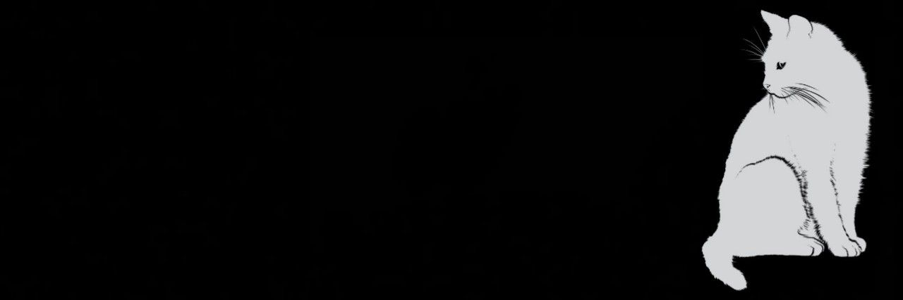

<!-- APRESENTAÇÃO -->
<h1 align="center">⊹ ࣪ ˖ 𝘏𝘦𝘭𝘭𝘰, 𝘞𝘰𝘳𝘭𝘥 ⊹ ࣪ ˖</h1>

  <i>learning to code, creating my future.</i>

  ──────୨ৎ────────୨ৎ────────୨ৎ────────୨ৎ────

<!-- SOBRE MIM -->
<h3 align="center">ABOUT ME</h3>

  A curious mind exploring the world of technology.
   
  Currently learning programming and building my skills
  one line of code at a time.
    
  <i>less perfection, more progress.</i>

<!-- TECNOLOGIAS -->
<h3 align="center">TECHNOLOGIES</h3>

  
  
  
  

<!-- OBJETIVOS -->
<h3 align="center">CURRENTLY</h3>

  ★ learning C and problem solving
   
  ★ improving my programming skills
   
  ★ exploring new possibilities

  ────୨ৎ────────୨ৎ────────୨ৎ────────୨ৎ────────୨ৎ────
    
  <i>「 one day or day one 」</i>

